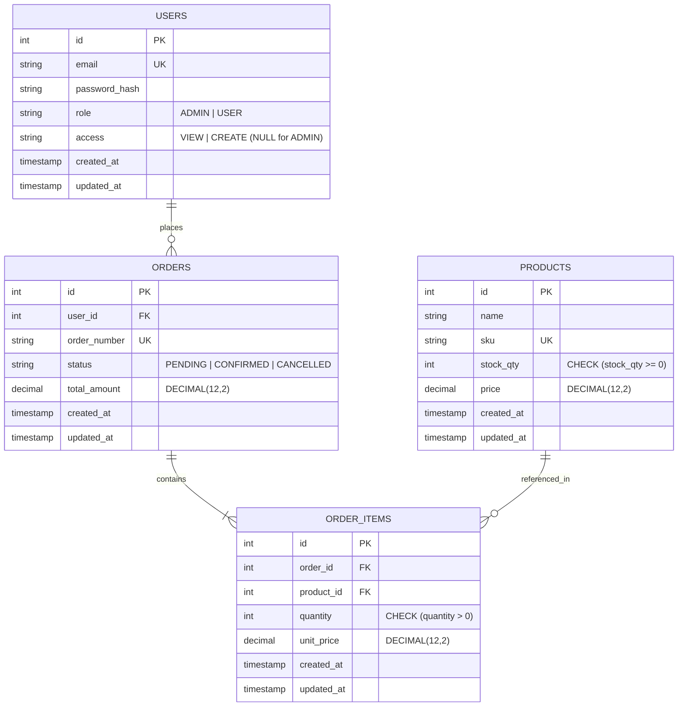

# Logistics Order & Inventory Management Platform

> Concurrency-safe logistics order management service featuring deterministic row-level inventory locking, strict Role-Based Access Control (RBAC), integer-cents financial precision, and an accessible React frontend.

---

## Live Demo

- **URL**: [https://nldassignment.vercel.app/login](https://nldassignment.vercel.app/login)
- **Demo Credentials** (seeded accounts):

| Role / Access | Email | Password | Permissions Summary |
| :--- | :--- | :--- | :--- |
| **ADMIN** | `admin@example.com` | `Admin@123` | Full access: manage catalog, confirm/cancel any order, view all orders |
| **USER (CREATE)** | `create@example.com` | `Create@123` | Catalog browse, cart, checkout, view & cancel own orders |
| **USER (VIEW)** | `view@example.com` | `View@123` | Read-only catalog & own orders; checkout and cancel disabled (UI explains why) |

*(The login page includes 1-click buttons to instantly populate these accounts).*

---

## Role-Wise Functionality

Verified directly against backend middlewares (`authorize`, `requireAccess`) and service guards:

| Capability | ADMIN | USER (`CREATE`) | USER (`VIEW`) | Code Enforcement |
| :--- | :---: | :---: | :---: | :--- |
| **Browse Catalog (`GET /products`)** | Yes | Yes | Yes | `authenticate` (any valid JWT) |
| **Manage Products (`POST`, `PUT /products`)** | Yes | No | No | `authorize('ADMIN')` |
| **Cart & Place Orders (`POST /orders`)** | Yes | Yes | No | `requireAccess('CREATE')` (`VIEW` blocked with 403) |
| **View Own Orders (`GET /orders`, `/:id`)** | Yes | Yes | Yes | `user_id` query scoping in `orders.service.ts` |
| **View All Orders across System** | Yes | No | No | Admin bypasses `user_id` filter |
| **Cancel Orders (`POST /orders/:id/cancel`)** | Any order | Own orders | No | `requireAccess('CREATE')` + ownership check |
| **Confirm Orders (`POST|PATCH /orders/:id/confirm`)** | Yes | No | No | `authorize('ADMIN')` |

---

## Tech Stack

- **Backend**: Node.js 20, Express 4, TypeScript 5, Sequelize ORM 6, Zod, Pino, Helmet, CORS
- **Frontend**: React 18, TypeScript 5, Vite 5, React Router 6, Plain CSS Custom Properties (zero UI kits)
- **Database**: PostgreSQL 16 (pessimistic row locks `SELECT ... FOR UPDATE`, check constraints, composite indexes)
- **Authentication**: JWT (Bearer tokens), bcrypt password hashing (cost factor 12)
- **Testing**: Jest 29 & Supertest (backend + 20-thread concurrency), Vitest 4 & Happy-DOM (frontend)

---

## Architecture

### Directory Tree (2 Levels)
```text
nld_assignment/
├── api/                  # Vercel serverless function entrypoint (index.js)
├── backend/
│   ├── src/              # Express app, config, middlewares, modules, models, db
│   ├── Dockerfile        # Container build definition
│   └── package.json      # Backend scripts and dependencies
├── frontend/
│   ├── src/              # React components, contexts, features, styles
│   └── package.json      # Frontend scripts and dependencies
├── docs/
│   ├── openapi.json      # OpenAPI 3.0 specification export
│   └── postman/          # Postman collection
├── docker-compose.yml    # PostgreSQL 16 (primary :5432, test :5433)
├── package.json          # Root monorepo orchestration scripts
└── vercel.json           # Vercel deployment routing & function config
```

### Layering & Key Design Principles
Routes dispatch to Controllers for payload validation (Zod), then to Services where business logic and transactions reside:
- **Deadlock-Free Row Locking**: Line items are merged by SKU and product IDs are sorted ascending (`order: [['id', 'ASC']]`) before acquiring `SELECT ... FOR UPDATE` row locks. This enforces a consistent global locking hierarchy and eliminates circular wait deadlocks.
- **Zero-Negative-Stock Guarantee**: In addition to runtime validation (`stock >= requestedQty`), PostgreSQL enforces `CHECK (stock_qty >= 0)` at the engine level as a safety net against race conditions.
- **Double-Cancel Safe Inventory Restoration**: Order cancellation runs inside an atomic transaction, verifying `PENDING` or `CONFIRMED` status before marking `CANCELLED` and restoring stock. Subsequent cancellation attempts return `409 Conflict`.
- **No Floating-Point Drift**: Prices are computed in integer cents (`Math.round(price * 100) * qty`) and converted to two-decimal strings only at API boundaries.
- **No N+1 Queries**: Order queries calculate item counts via SQL scalar subqueries and leverage composite indexes on `(user_id, created_at DESC)` and `(status, created_at DESC)`.

### Entity-Relationship Diagram


---

## Getting Started (Local)

### Prerequisites & Quick Start
Prerequisites: **Node.js 20+**, **npm 10+**, **Docker & Docker Compose**.

```bash
# 1. Clone & start PostgreSQL containers (primary :5432, test :5433)
git clone https://github.com/sumitranot/nld_assignment.git && cd nld_assignment
docker compose up -d

# 2. Copy environment configuration & install dependencies
cp backend/.env.example backend/.env
npm install && cd backend && npm install && cd ../frontend && npm install && cd ..

# 3. Run migrations, seed demo data, and start dev servers
npm run db:migrate && npm run db:seed
# Backend (http://localhost:3000 | Swagger: /docs)
cd backend && npm run dev
# Frontend (http://localhost:5173 - open another terminal)
cd frontend && npm run dev
```

### Environment Variables (`backend/.env`)

| Variable | Purpose | Example |
| :--- | :--- | :--- |
| `NODE_ENV` / `PORT` | Runtime mode and backend HTTP port | `development` / `3000` |
| `DB_HOST` / `DB_PORT` | PostgreSQL host and port | `localhost` / `5432` |
| `DB_NAME` / `DB_USER` / `DB_PASSWORD` | PostgreSQL credentials | `nld_db` / `nld_user` / `nld_password` |
| `JWT_SECRET` / `JWT_EXPIRES_IN` | JWT signing key ($\ge 32$ chars) and expiry | `nld-super-secure-production-jwt-secret-key-32chars` / `24h` |
| `CORS_ORIGIN` | Allowed client origin for CORS | `http://localhost:5173` |
| `ALLOW_ADMIN_REGISTRATION` | Permit public self-registration of `ADMIN` role | `true` (dev) / `false` (prod) |

### Running Tests
```bash
npm test                               # Run all tests (backend Jest + frontend Vitest)
cd backend && npm test                 # Backend tests only (includes 20-thread concurrency test)
cd frontend && npm test                # Frontend unit & integration tests only
```

---

## API Overview

Interactive Swagger UI: `http://localhost:3000/docs` (OpenAPI: [`docs/openapi.json`](docs/openapi.json) | Postman: [`docs/postman/NLD-Assessment.postman_collection.json`](docs/postman/NLD-Assessment.postman_collection.json)).

| Method | Endpoint | Auth / Role | Description | Status Codes |
| :--- | :--- | :--- | :--- | :--- |
| `GET` | `/health` | Public | System status and timestamp | `200` |
| `GET` | `/docs` / `/docs/openapi.json` | Public | Interactive Swagger UI & OpenAPI 3.0 spec | `200` |
| `POST` | `/auth/register` | Public | Register customer account (`VIEW` or `CREATE`) | `201`, `400`, `409` |
| `POST` | `/auth/login` | Public | Authenticate user and receive JWT token | `200`, `400`, `401` |
| `GET` | `/auth/me` | Bearer | Retrieve active user profile | `200`, `401` |
| `GET` | `/products` / `/:id` | Bearer | List paginated products (`page`, `limit`, `q`) or get by ID | `200`, `401`, `404` |
| `POST` | `/products` | `ADMIN` | Create warehouse product (`name`, `sku`, `stockQty`, `price`) | `201`, `400`, `403`, `409` |
| `PUT` | `/products/:id` | `ADMIN` | Update warehouse product fields and stock | `200`, `400`, `403`, `404`, `409` |
| `GET` | `/orders` / `/:id` | Bearer | Paginated orders (own for USER, all for ADMIN) or single order | `200`, `401`, `404` |
| `POST` | `/orders` | `CREATE` / `ADMIN` | Place order with transactional inventory decrement | `201`, `400`, `403`, `409` |
| `POST` | `/orders/:id/cancel` | `CREATE` / `ADMIN` | Cancel pending/confirmed order and restore stock | `200`, `401`, `404`, `409` |
| `POST` | `/orders/:id/confirm` | `ADMIN` | Confirm order status (`PENDING` $\to$ `CONFIRMED`) | `200`, `401`, `403`, `404`, `409` |

---

## Assumptions & Trade-offs

- **Access Level Default**: New registrations default to `VIEW` access if omitted; `CREATE` access implicitly inherits `VIEW` access.
- **Admin Self-Registration Guard**: Public registration of `ADMIN` accounts is blocked unless `ALLOW_ADMIN_REGISTRATION=true`.
- **Order Lifecycle**: Orders start in `PENDING`. Only `PENDING` and `CONFIRMED` orders may be cancelled. Once cancelled, repeat cancellations return `409 Conflict`.
- **Privacy Preservation (404 vs 403)**: Non-admin users requesting orders belonging to another customer receive `404 Not Found` (not `403`) to prevent order ID enumeration.
- **Snapshot Unit Pricing**: Item prices are snapshotted into `order_items.unit_price` at checkout. Subsequent catalog price adjustments do not alter historical orders.
- **Deterministic SKU Gradient**: Product card artwork is generated deterministically from SKU characters using an algorithmic HSL mesh, avoiding external image dependencies.
- **Collision-Resistant Order Numbers**: Format `ORD-YYYYMMDD-XXXXX` with automatic retry (up to 5 attempts) on unique key collisions.
