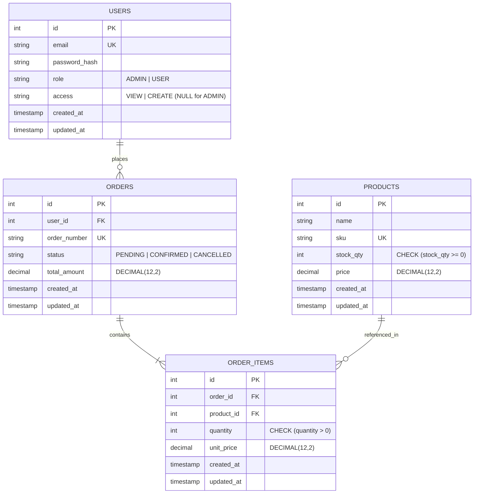

# Logistics Order & Inventory Management Platform

> Concurrency-safe logistics order management service featuring deterministic row-level inventory locking, strict Role-Based Access Control (RBAC), integer-cents financial precision, and an accessible React frontend.

---

## Live Demo

- **Production URL**: [https://nldassignment.vercel.app/login](https://nldassignment.vercel.app/login)
- **Demo Credentials** (seeded accounts):

| Role / Access | Email | Password | Permissions Summary |
| :--- | :--- | :--- | :--- |
| **ADMIN** | `admin@example.com` | `Admin@123` | Full access: manage catalog, confirm/cancel any order, view all orders |
| **USER (CREATE)** | `create@example.com` | `Create@123` | Catalog browse, cart, checkout, view & cancel own orders |
| **USER (VIEW)** | `view@example.com` | `View@123` | Read-only catalog & own orders; checkout and cancel disabled (UI explains why) |

*(The login page provides 1-click buttons to instantly populate these accounts).*

---

## Role-Wise Functionality

Verified directly against backend middlewares (`authorize`, `requireAccess`) and service guards:

| Capability | ADMIN | USER (`CREATE`) | USER (`VIEW`) | Code Enforcement |
| :--- | :---: | :---: | :---: | :--- |
| **Browse Catalog (`GET /products`)** | Yes | Yes | Yes | `authenticate` (any valid JWT) |
| **Manage Products (`POST`, `PUT /products`)** | Yes | No | No | `authorize('ADMIN')` |
| **Cart & Place Orders (`POST /orders`)** | Yes | Yes | No | `requireAccess('CREATE')` (`VIEW` blocked with 403) |
| **View Own Orders (`GET /orders`, `/:id`)** | Yes | Yes | Yes | `user_id` query scoping in `orders.service.ts` |
| **View All Orders across System** | Yes | No | No | Admin bypasses `user_id` filter |
| **Cancel Orders (`POST /orders/:id/cancel`)** | Any order | Own orders | No | `requireAccess('CREATE')` + ownership check |
| **Confirm Orders (`POST|PATCH /orders/:id/confirm`)** | Yes | No | No | `authorize('ADMIN')` |

---

## Tech Stack

- **Backend**: Node.js 20, Express 4, TypeScript 5, Sequelize ORM 6, Zod, Pino, Helmet, CORS
- **Frontend**: React 18, TypeScript 5, Vite 5, React Router 6, Plain CSS Custom Properties (zero UI kits)
- **Database**: PostgreSQL 16 (pessimistic row locks `SELECT ... FOR UPDATE`, check constraints, composite indexes)
- **Authentication**: JWT (Bearer tokens), bcrypt password hashing (cost factor 12)
- **Testing**: Jest 29 & Supertest (backend + 20-thread concurrency), Vitest 4 & Happy-DOM (frontend)

---

## Architecture

### Monorepo Directory Structure

```text
nld_assignment/
├── api/
│   └── index.js                        # Vercel serverless function entrypoint (CommonJS)
├── backend/
│   ├── src/
│   │   ├── config/
│   │   │   └── env.ts                  # Zod-validated environment configuration & fallbacks
│   │   ├── db/
│   │   │   ├── migrations/             # Database migrations (users, products, orders, items)
│   │   │   ├── models/                 # User, Product, Order, OrderItem models & associations
│   │   │   ├── seeders/                # Seed data for demo users & realistic warehouse products
│   │   │   └── sequelize.ts            # Sequelize instance, connection pooling & dialect configuration
│   │   ├── docs/
│   │   │   └── openapi.json            # OpenAPI 3.0 specification
│   │   ├── middlewares/
│   │   │   ├── authenticate.ts         # JWT verification & user session hydration
│   │   │   ├── authorize.ts            # Role-based guard (e.g. ADMIN only)
│   │   │   ├── requireAccess.ts        # Granular access check (CREATE implies VIEW, ADMIN bypass)
│   │   │   ├── rateLimiter.ts          # Express rate limiting
│   │   │   ├── validate.ts             # Generic Zod request schema validator
│   │   │   ├── notFound.ts             # 404 handler returning standard error format
│   │   │   └── errorHandler.ts         # Centralized error handler (AppError, Sequelize, syntax)
│   │   ├── modules/
│   │   │   ├── auth/                   # Controller, service, routes, validators, DTOs & tests
│   │   │   ├── products/               # Inventory CRUD, ILIKE search, DTOs & tests
│   │   │   └── orders/                 # Checkout, row locks, cancel, confirm, DTOs & tests
│   │   ├── utils/
│   │   │   ├── AppError.ts             # Operational error hierarchy (BadReq, Unauthorized, etc.)
│   │   │   ├── money.ts                # Zero-drift integer cents math & formatting
│   │   │   ├── pagination.ts           # Safe pagination query parser & metadata builder
│   │   │   ├── logger.ts               # Pino structured JSON logger
│   │   │   └── asyncHandler.ts         # Express async route wrapper
│   │   ├── app.ts                      # Express app initialization, Swagger UI, & route mounts
│   │   └── server.ts                   # Standalone HTTP server bootstrap & graceful shutdown
│   ├── Dockerfile                      # Containerized backend build
│   ├── jest.config.js                  # Jest testing configuration
│   ├── package.json                    # Backend dependencies & npm scripts
│   └── tsconfig.json                   # Strict TypeScript compiler options
├── frontend/
│   ├── src/
│   │   ├── api/                        # Axios HTTP client, interceptors & typed API modules
│   │   ├── components/                 # Button, Input, Modal, Navbar, Pagination, Spinner, Toast
│   │   ├── context/                    # AuthContext, CartContext, ToastContext
│   │   ├── features/
│   │   │   ├── auth/                   # LoginPage, RegisterPage, demo quick-fill buttons
│   │   │   ├── products/               # ProductsPage, AdminProductsPage, product card, modals
│   │   │   ├── cart/                   # CartPage, quantity adjustments, checkout flow
│   │   │   └── orders/                 # OrdersPage, AdminOrdersPage, OrderDetailDrawer
│   │   ├── hooks/                      # useDebounce, useToast, custom utilities
│   │   ├── lib/                        # Deterministic SKU gradient generator, money helpers
│   │   ├── styles/                     # variables.css (tokens), global.css (reset & base rules)
│   │   ├── App.tsx                     # Root component with provider wrapping
│   │   ├── routes.tsx                  # ProtectedRoute guards & React Router tree
│   │   └── main.tsx                    # React DOM entrypoint
│   ├── package.json                    # Frontend dependencies & npm scripts
│   ├── tsconfig.json                   # Strict TypeScript configuration
│   └── vite.config.ts                  # Vite development server, proxy configuration & Vitest setup
├── docs/
│   ├── openapi.json                    # Exported OpenAPI 3.0 specification
│   └── postman/
│       └── NLD-Assessment.postman_collection.json  # Importable Postman collection with test assertions
├── docker-compose.yml                  # PostgreSQL 16 containers (primary :5432, test :5433)
├── package.json                        # Root monorepo orchestration scripts
└── vercel.json                         # Vercel serverless routing, header bypass & bundle config
```

### Layering & Key Design Principles

Routes dispatch to Controllers for payload validation (Zod), then to Services where business logic and transactions reside:

- **Deadlock-Free Row Locking**: Line items are merged by SKU and product IDs are sorted ascending (`order: [['id', 'ASC']]`) before acquiring `SELECT ... FOR UPDATE` row locks. This enforces a consistent global locking hierarchy and eliminates circular wait deadlocks.
- **Zero-Negative-Stock Guarantee**: In addition to runtime validation (`stock >= requestedQty`), PostgreSQL enforces `CHECK (stock_qty >= 0)` at the engine level as a safety net against race conditions.
- **Double-Cancel Safe Inventory Restoration**: Order cancellation runs inside an atomic transaction, verifying `PENDING` or `CONFIRMED` status before marking `CANCELLED` and restoring stock. Subsequent cancellation attempts return `409 Conflict`.
- **No Floating-Point Drift**: Prices are computed in integer cents (`Math.round(price * 100) * qty`) and converted to two-decimal strings only at API boundaries.
- **No N+1 Queries**: Order queries calculate item counts via SQL scalar subqueries and leverage composite indexes on `(user_id, created_at DESC)` and `(status, created_at DESC)`.

### Entity-Relationship Diagram



---

## Available Scripts

### Root Monorepo (`package.json`)

| Command | Description |
| :--- | :--- |
| `npm run build` | Builds both backend (`tsc`) and frontend (`tsc && vite build`) |
| `npm run build:backend` | Installs dependencies and compiles backend TypeScript |
| `npm run build:frontend` | Installs dependencies and builds frontend production assets |
| `npm run db:migrate` | Runs all pending database migrations via Sequelize CLI |
| `npm run db:seed` | Seeds initial demonstration users and warehouse catalog items |
| `npm test` | Runs both backend Jest test suite and frontend Vitest suite |

### Backend Service (`backend/package.json`)

| Command | Description |
| :--- | :--- |
| `npm run dev` | Starts development server with hot-reloading (`tsx watch src/server.ts`) |
| `npm run build` | Compiles TypeScript source to production JavaScript (`tsc`) into `dist/` |
| `npm start` | Boots compiled production server (`node dist/server.js`) |
| `npm test` | Executes Jest test suites in-band (`jest --runInBand --forceExit`) |
| `npm run migrate` | Applies pending database migrations (`npx sequelize-cli db:migrate`) |
| `npm run seed` | Seeds database with demo accounts and products (`npx sequelize-cli db:seed:all`) |
| `npm run lint` / `npm run lint:fix` | Runs ESLint analysis / auto-fixes formatting issues |
| `npm run format` | Formats all TypeScript files using Prettier |

### Frontend Application (`frontend/package.json`)

| Command | Description |
| :--- | :--- |
| `npm run dev` | Launches Vite local development server with API proxy on `http://localhost:5173` |
| `npm run build` | Executes TypeScript typecheck and bundles production assets into `dist/` |
| `npm run preview` | Locally serves production build for verification |
| `npm test` | Runs Vitest unit and integration test suites |
| `npm run lint` / `npm run format` | Runs ESLint check / formats source files with Prettier |

---

## Getting Started (Local Setup & How to Start)

### Prerequisites

- **Node.js**: v20.x or higher
- **npm**: v10.x or higher
- **Docker & Docker Compose** (for local PostgreSQL containers)

### Step-by-Step Setup

```bash
# 1. Clone the repository
git clone https://github.com/sumitranot/nld_assignment.git
cd nld_assignment

# 2. Start PostgreSQL primary (port 5432) and test database (port 5433)
docker compose up -d

# 3. Configure backend environment
cp backend/.env.example backend/.env

# 4. Install dependencies across root, backend, and frontend
npm install
cd backend && npm install && cd ..
cd frontend && npm install && cd ..

# 5. Run database migrations and seed data
npm run db:migrate
npm run db:seed

# 6. Start the development servers
# Terminal 1: Backend service (http://localhost:3000 | Docs: http://localhost:3000/docs)
cd backend && npm run dev

# Terminal 2: Frontend application (http://localhost:5173)
cd frontend && npm run dev
```

### Environment Variables (`backend/.env`)

| Variable | Purpose | Example / Default |
| :--- | :--- | :--- |
| `NODE_ENV` | Application environment mode | `development` |
| `PORT` | Backend HTTP listening port | `3000` |
| `DB_HOST` / `DB_PORT` | PostgreSQL host and port | `localhost` / `5432` |
| `DB_NAME` / `DB_USER` / `DB_PASSWORD` | PostgreSQL connection credentials | `nld_db` / `nld_user` / `nld_password` |
| `JWT_SECRET` | Secret key for signing JWT tokens ($\ge 32$ chars) | `nld-super-secure-production-jwt-secret-key-32chars` |
| `JWT_EXPIRES_IN` | Token expiration period | `24h` |
| `CORS_ORIGIN` | Allowed client origin for CORS | `http://localhost:5173` |
| `ALLOW_ADMIN_REGISTRATION` | Permit public self-registration of `ADMIN` role | `true` (dev) / `false` (prod) |

### How to Run Tests

```bash
# Run all tests across the repository (backend Jest + frontend Vitest)
npm test

# Run backend tests only (includes 20-thread concurrency stress test in orders.test.ts)
cd backend && npm test

# Run frontend tests only (CartContext, ProtectedRoute, UI components)
cd frontend && npm test
```

---

## API Overview

Interactive Swagger UI: `http://localhost:3000/docs` (OpenAPI schema: [`docs/openapi.json`](docs/openapi.json) | Postman: [`docs/postman/NLD-Assessment.postman_collection.json`](docs/postman/NLD-Assessment.postman_collection.json)).

| Method | Endpoint | Auth / Role | Description | Status Codes |
| :--- | :--- | :--- | :--- | :--- |
| `GET` | `/health` | Public | System status and timestamp | `200` |
| `GET` | `/docs` / `/docs/openapi.json` | Public | Interactive Swagger UI & OpenAPI 3.0 spec | `200` |
| `POST` | `/auth/register` | Public | Register customer account (`VIEW` or `CREATE`) | `201`, `400`, `409` |
| `POST` | `/auth/login` | Public | Authenticate user and receive JWT token | `200`, `400`, `401` |
| `GET` | `/auth/me` | Bearer | Retrieve active user profile | `200`, `401` |
| `GET` | `/products` / `/:id` | Bearer | List paginated products (`page`, `limit`, `q`) or get by ID | `200`, `401`, `404` |
| `POST` | `/products` | `ADMIN` | Create warehouse product (`name`, `sku`, `stockQty`, `price`) | `201`, `400`, `403`, `409` |
| `PUT` | `/products/:id` | `ADMIN` | Update warehouse product fields and stock | `200`, `400`, `403`, `404`, `409` |
| `GET` | `/orders` / `/:id` | Bearer | Paginated orders (own for USER, all for ADMIN) or single order | `200`, `401`, `404` |
| `POST` | `/orders` | `CREATE` / `ADMIN` | Place order with transactional inventory decrement | `201`, `400`, `403`, `409` |
| `POST` | `/orders/:id/cancel` | `CREATE` / `ADMIN` | Cancel pending/confirmed order and restore stock | `200`, `401`, `404`, `409` |
| `POST` | `/orders/:id/confirm` | `ADMIN` | Confirm order status (`PENDING` $\to$ `CONFIRMED`) | `200`, `401`, `403`, `404`, `409` |

---

## Assumptions & Trade-offs

- **Access Level Default**: New registrations default to `VIEW` access if omitted; `CREATE` access implicitly inherits `VIEW` access.
- **Admin Self-Registration Guard**: Public registration of `ADMIN` accounts is blocked unless `ALLOW_ADMIN_REGISTRATION=true`.
- **Order Lifecycle**: Orders start in `PENDING`. Only `PENDING` and `CONFIRMED` orders may be cancelled. Once cancelled, repeat cancellations return `409 Conflict`.
- **Privacy Preservation (404 vs 403)**: Non-admin users requesting orders belonging to another customer receive `404 Not Found` (not `403`) to prevent order ID enumeration.
- **Snapshot Unit Pricing**: Item prices are snapshotted into `order_items.unit_price` at checkout. Subsequent catalog price adjustments do not alter historical orders.
- **Deterministic SKU Gradient**: Product card artwork is generated deterministically from SKU characters using an algorithmic HSL mesh, avoiding external image dependencies.
- **Collision-Resistant Order Numbers**: Format `ORD-YYYYMMDD-XXXXX` with automatic retry (up to 5 attempts) on unique key collisions.
