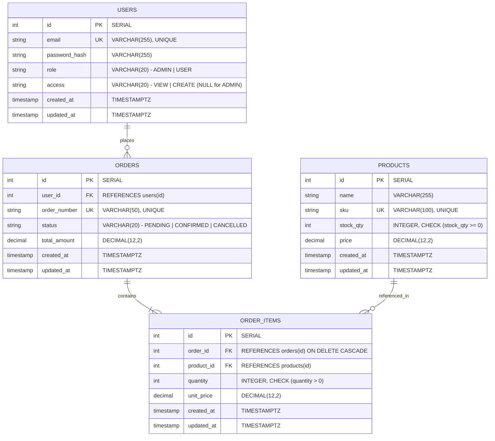

# NLD Logistics — Order Management Service

> **Enterprise Full-Stack Assessment**: High-throughput, concurrency-safe logistics order management platform with strict Role-Based Access Control (RBAC), deterministic pessimistic inventory locking, zero-drift integer cents accounting, and an accessible frontend.

[](https://nodejs.org/)
[](https://www.typescriptlang.org/)
[](https://www.postgresql.org/)
[](https://vitejs.dev/)
[](https://react.dev/)
[]()

---

## Table of Contents

1. [System Architecture](#system-architecture)
2. [Monorepo Directory Structure](#monorepo-directory-structure)
3. [Entity-Relationship (ER) Diagram](#entity-relationship-er-diagram)
4. [Concurrency Strategy & Zero-Negative-Stock Guarantee](#concurrency-strategy--zero-negative-stock-guarantee)
5. [Financial Precision & Money Handling](#financial-precision--money-handling)
6. [Role-Based Access Control (RBAC)](#role-based-access-control-rbac)
7. [API Reference & Interactive Documentation](#api-reference--interactive-documentation)
8. [Demo Credentials](#demo-credentials)
9. [How to Run (Quick Start)](#how-to-run-quick-start)
10. [How to Test](#how-to-test)
11. [Design Assumptions](#design-assumptions)
12. [Trade-offs & Production Roadmap](#trade-offs--production-roadmap)

---

## System Architecture

```
┌────────────────────────────────────────────────────────────────────────┐
│                              FRONTEND                                  │
│         React 18 + TypeScript + Vite + Plain CSS Custom Properties     │
│   (AuthContext, CartContext, ToastContext, ErrorBoundary, Components)  │
└───────────────────────────────────┬────────────────────────────────────┘
                                    │ HTTP / REST (Bearer JWT)
                                    ▼
┌────────────────────────────────────────────────────────────────────────┐
│                              BACKEND                                   │
│            Node.js + Express + TypeScript (Layered Architecture)       │
│                                                                        │
│   ┌────────────────────────────────────────────────────────────────┐   │
│   │ Middlewares: CORS, RateLimiter, JWT Authenticate, RBAC Authorize│   │
│   │              requireAccess, Zod Request Validator, ErrorHandler │   │
│   └───────────────────────────────┬────────────────────────────────┘   │
│                                   │                                    │
│   ┌───────────────────────────────▼────────────────────────────────┐   │
│   │ Controllers & Services: Auth, Products, Orders                 │   │
│   │  - Merge SKUs                                                  │   │
│   │  - Deterministic Row Ordering (ID ASC)                         │   │
│   │  - Integer Cents Calculation (Zero Floating-Point Drift)       │   │
│   │  - Order Number Collision Retry (Up to 5 attempts)             │   │
│   └───────────────────────────────┬────────────────────────────────┘   │
│                                   │ Sequelize ORM                      │
│                                   ▼                                    │
│   ┌────────────────────────────────────────────────────────────────┐   │
│   │ PostgreSQL 16 (Pessimistic Row Locks `FOR UPDATE` + CHECK Cons)│   │
│   └────────────────────────────────────────────────────────────────┘   │
└────────────────────────────────────────────────────────────────────────┘
```

The system employs a strict separation of concerns across both backend and frontend:

- **Backend**: Express modular architecture with `dto`, `validators` (Zod), `service`, `controller`, and `routes`. All database state transitions occur inside isolated transactions.
- **Frontend**: Lightweight React 18 single-page app avoiding heavy external UI frameworks (no Tailwind, Bootstrap, or Material UI) using semantic CSS variables, custom state contexts (`AuthContext`, `CartContext`, `ToastContext`), and debounced queries.
- **API Documentation**: OpenAPI 3.0 specification served interactively via Swagger UI at `/docs` and exported to `/docs/openapi.json` alongside a complete Postman collection.

---

## Monorepo Directory Structure

```
nld_assignment/
├── backend/
│   ├── src/
│   │   ├── config/             # Zod-validated environment variables
│   │   ├── db/                 # Sequelize instance and migrations configuration
│   │   ├── docs/               # OpenAPI 3.0 schema definition
│   │   ├── middlewares/        # Auth, RBAC, Access Check, Validation, Error Handler
│   │   ├── migrations/         # 4 Knex/Sequelize database migrations
│   │   ├── models/             # User, Product, Order, OrderItem models & relations
│   │   ├── modules/
│   │   │   ├── auth/           # Login, register, profile, tokens & tests
│   │   │   ├── products/       # Inventory search, create, update & tests
│   │   │   └── orders/         # Concurrency locking, checkout, cancel & tests
│   │   ├── seeders/            # Seed data for demo users and warehouse products
│   │   ├── utils/              # AppError, money math, pagination, logger
│   │   ├── app.ts              # Express application setup and route mounting
│   │   └── server.ts           # HTTP server bootstrapping and graceful shutdown
│   ├── .eslintrc.cjs
│   ├── jest.config.js
│   ├── package.json
│   └── tsconfig.json
├── frontend/
│   ├── src/
│   │   ├── api/                # Axios client, typed endpoints (auth, products, orders)
│   │   ├── components/         # Modal, Navbar, Pagination, Spinner, ErrorBoundary
│   │   ├── context/            # AuthContext, CartContext, ToastContext
│   │   ├── features/           # Auth (Login/Register), Products, Cart, Orders
│   │   ├── hooks/              # useDebounce, etc.
│   │   ├── pages/              # AdminProductsPage (inventory management)
│   │   ├── styles/             # Plain CSS variables and responsive design rules
│   │   ├── App.tsx             # Root component with providers
│   │   └── routes.tsx          # React Router v6 guarded route hierarchy
│   ├── package.json
│   ├── tsconfig.json
│   └── vite.config.ts
├── docs/
│   ├── openapi.json            # Static OpenAPI 3.0 export
│   └── postman/                # Exported Postman collection with test scripts
├── docker-compose.yml          # PostgreSQL 16 containers (primary 5432, test 5433)
└── README.md
```

---

## Entity-Relationship (ER) Diagram



### Key Database Constraints & Indexes

1. **`CHECK (stock_qty >= 0)`**: Enforced on the `products` table at the database engine level. Even if an unhandled thread race were to attempt decrementation below zero, PostgreSQL rejects the transaction immediately.
2. **`UNIQUE(sku)`**: Ensures strict warehouse SKU uniqueness.
3. **`UNIQUE(order_number)`**: Enforces collision resistance for human-readable order identifiers (`ORD-YYYYMMDD-XXXXX`).
4. **Composite Indexes**:
   - `orders (user_id, created_at DESC)`: High-performance customer order queries.
   - `orders (status, created_at DESC)`: Rapid administrative order queue filtering.
   - `order_items (order_id)`: Sub-millisecond join times for order fulfillment.

---

## Concurrency Strategy & Zero-Negative-Stock Guarantee

In logistics and warehousing systems, overselling inventory causes severe real-world operational failure. This system guarantees that **inventory never drops below zero**, even under high parallel concurrency.

### 1. Deterministic Lock Ordering (`order: [['id', 'ASC']]`)

When multiple concurrent checkout transactions attempt to purchase overlapping sets of products (e.g. Transaction A requests products `[1, 5]`, while Transaction B requests products `[5, 1]`), naive row locking creates circular wait graphs, resulting in PostgreSQL deadlocks:

```
Transaction A: Lock(Product 1) ──► Wants Lock(Product 5) [BLOCKED]
Transaction B: Lock(Product 5) ──► Wants Lock(Product 1) [BLOCKED] ──► DEADLOCK
```

**Our Solution**: The order placement engine groups and deduplicates incoming line items by SKU, resolves their primary keys, and sorts them ascending by `id`:

```typescript
const products = await Product.findAll({
  where: { sku: Array.from(productMap.keys()) },
  order: [['id', 'ASC']], // Deterministic ascending lock hierarchy
  lock: t.LOCK.UPDATE,   // SELECT ... FOR UPDATE
  transaction: t,
});
```

Because every concurrent transaction locks products in the exact same physical order, **circular wait is mathematically impossible**.

### 2. Pessimistic Row Locking (`SELECT ... FOR UPDATE`)

1. Inside a PostgreSQL transaction, `t.LOCK.UPDATE` places an exclusive row-level lock on the selected product records.
2. Competing concurrent transactions requesting the same products wait queue-style until the holding transaction commits or rolls back.
3. The service verifies `product.stockQty >= requestedQty`. If insufficient, a `409 Conflict` error is returned, rolling back all locks without modifying any row.
4. If sufficient, `product.stockQty -= requestedQty` is executed atomically.

### 3. Database Safety Net (`CHECK (stock_qty >= 0)`)

PostgreSQL migration enforces:
```sql
ALTER TABLE "products" ADD CONSTRAINT "chk_products_stock_qty_non_negative" CHECK (stock_qty >= 0);
```

### 4. Stress Test Verification

This concurrency guarantee is validated by an automated integration stress test in [`backend/src/modules/orders/orders.test.ts`](file:///c:/Users/sumit/Documents/sumit_office/interview/nld_assignment/backend/src/modules/orders/orders.test.ts):
- Initial warehouse inventory: **5 units**.
- Concurrent parallel requests: **20 simultaneous orders** fired via `Promise.all`.
- Result: **Exactly 5 orders succeed with HTTP 201**, **exactly 15 orders fail with HTTP 409 Conflict**, and **final warehouse inventory is exactly 0**.

---

## Financial Precision & Money Handling

Floating-point representations (IEEE 754 `float`/`double`) suffer from cumulative rounding errors (e.g., `0.1 + 0.2 === 0.30000000000000004`). In logistics invoicing, even fractional-cent rounding errors cause accounting imbalances.

### The Integer Cents Architecture

Our system enforces zero-drift accounting using a specialized money utility ([`backend/src/utils/money.ts`](file:///c:/Users/sumit/Documents/sumit_office/interview/nld_assignment/backend/src/utils/money.ts)):

1. **Storage**: Stored in PostgreSQL as `DECIMAL(12,2)`.
2. **Runtime Math**: When calculating prices, line totals, discounts, or grand totals, all dollar strings are converted to **integer cents**:
   $$\text{cents} = \text{Math.round}(\text{parseFloat}(\text{decimalString}) \times 100)$$
3. **Multiplication**: Item quantity is multiplied by unit cents:
   $$\text{lineTotalCents} = \text{unitPriceCents} \times \text{integerQty}$$
4. **Summation**: Line totals are summed as standard integers and formatted back to two-place decimal strings only at the final boundary:
   $$\text{totalAmount} = (\text{totalCents} / 100)\text{.toFixed(2)}$$
5. **Snapshot Pricing**: `unitPrice` is snapshotted onto `order_items` at the exact second the order is placed. Subsequent price adjustments to warehouse catalog items never alter historical order invoices.

---

## Role-Based Access Control (RBAC)

The application implements a multi-tier permission matrix:

| Role | Access Level | Browse Catalog | Place Orders | View Own Orders | View All Orders | Cancel Orders | Confirm Orders | Manage Inventory |
| :--- | :--- | :---: | :---: | :---: | :---: | :---: | :---: | :---: |
| **USER** | `VIEW` | Yes | No | Yes | No | Yes (own) | No | No |
| **USER** | `CREATE` | Yes | Yes | Yes | No | Yes (own) | No | No |
| **ADMIN** | *Bypass* | Yes | Yes | Yes | Yes | Yes (any) | Yes | Yes |

### Key Security Safeguards

- **`CREATE` implies `VIEW`**: Any user granted `CREATE` privileges automatically inherits `VIEW` privileges.
- **Admin Bypass**: Users with the `ADMIN` role automatically bypass granular user access restrictions.
- **Privacy Preservation (404 vs 403)**: When a standard `USER` requests or attempts to cancel an order belonging to another customer, the service returns **`404 Not Found`** instead of `403 Forbidden`. This prevents malicious actors from enumerating valid order IDs across the enterprise.
- **Re-Verification on Request**: The authentication middleware re-verifies the user's active status and role against the database on each request, ensuring immediate revocation if an administrator changes privileges.

---

## API Reference & Interactive Documentation

The backend serves an interactive **Swagger UI** at:
👉 **`http://localhost:3000/docs`**

A machine-readable OpenAPI 3.0 specification is available at `GET /docs/openapi.json` and mirrored in [`docs/openapi.json`](file:///c:/Users/sumit/Documents/sumit_office/interview/nld_assignment/docs/openapi.json). A ready-to-import Postman collection is located at [`docs/postman/NLD-Assessment.postman_collection.json`](file:///c:/Users/sumit/Documents/sumit_office/interview/nld_assignment/docs/postman/NLD-Assessment.postman_collection.json).

### Core Endpoints Summary

| Method | Endpoint | Auth | Description | Status Codes |
| :--- | :--- | :--- | :--- | :--- |
| `GET` | `/health` | Public | System health and database connectivity check | `200`, `503` |
| `POST` | `/auth/register` | Public | Register new customer account (`USER`, access `VIEW` or `CREATE`) | `201`, `400`, `409` |
| `POST` | `/auth/login` | Public | Authenticate user, receive JWT Bearer token | `200`, `400`, `401` |
| `GET` | `/auth/me` | Bearer | Get current authenticated user profile | `200`, `401` |
| `GET` | `/products` | Bearer | Paginated catalog (`page`, `limit`, `search`) | `200`, `401` |
| `POST` | `/products` | `ADMIN` | Create new warehouse product (`sku`, `name`, `stockQty`, `price`) | `201`, `400`, `403`, `409` |
| `PUT` | `/products/:id` | `ADMIN` | Update existing product details or stock | `200`, `400`, `403`, `404`, `409` |
| `GET` | `/orders` | Bearer | Paginated order history (filters: `status`, `from`, `to`, `userId`) | `200`, `401` |
| `GET` | `/orders/:id` | Bearer | Get order details with line items and snapshot prices | `200`, `401`, `404` |
| `POST` | `/orders` | `CREATE` / `ADMIN` | Place new order with concurrency-safe stock decrement | `201`, `400`, `403`, `409` |
| `POST` | `/orders/:id/cancel` | Bearer | Cancel order (`PENDING` or `CONFIRMED`) and restore inventory | `200`, `401`, `404`, `409` |
| `POST` | `/orders/:id/confirm` | `ADMIN` | Confirm order status (`PENDING` $\to$ `CONFIRMED`) | `200`, `401`, `403`, `404`, `409` |

---

## Demo Credentials

The database seeder automatically provisions 3 demonstration accounts with bcrypt-hashed credentials (cost 12):

| Account Type | Email | Password | Role | Access Level | Description |
| :--- | :--- | :--- | :---: | :---: | :--- |
| **Administrator** | `admin@nld.local` | `AdminPass123!` | `ADMIN` | Full | Can manage inventory, confirm orders, and view all system records. |
| **Creator User** | `creator@nld.local` | `CreatorPass123!` | `USER` | `CREATE` | Can browse inventory, add items to cart, and checkout orders. |
| **Viewer User** | `viewer@nld.local` | `ViewerPass123!` | `USER` | `VIEW` | Can view products and order history, but ordering and cart are restricted. |

> **Pro Tip**: The Frontend Login page features **1-Click Demo Fill** buttons to instantly log in as any of these users.

---

## How to Run (Quick Start)

### Prerequisites

- **Node.js**: v20.x or higher
- **npm**: v10.x or higher
- **Docker & Docker Compose** (or a local PostgreSQL 16 instance)

### 1. Start PostgreSQL with Docker Compose

```bash
# Start primary PostgreSQL (port 5432) and test database (port 5433)
docker compose up -d
```

### 2. Configure & Seed the Backend

```bash
cd backend

# Install dependencies
npm install

# Run database migrations
npx sequelize-cli db:migrate

# Seed demo users and realistic warehouse catalog items
npx sequelize-cli db:seed:all

# Start backend development server
npm run dev
```

*The backend will boot on `http://localhost:3000`.*
*Interactive API docs available at `http://localhost:3000/docs`.*

### 3. Start the Frontend Application

```bash
cd ../frontend

# Install dependencies
npm install

# Start Vite development server
npm run dev
```

*The frontend will boot on `http://localhost:5173`.*

---

## How to Test

### 1. Run Backend Test Suite (61 Tests)

```bash
cd backend
npm test
```

The backend test suite executes 7 test suites covering:
- **`app.test.ts`**: Health check, OpenAPI spec generation, 404 handler.
- **`money.test.ts`**: Zero-drift integer cents arithmetic, rounding, multiplication.
- **`pagination.test.ts`**: Boundary conditions, limit capping, sanitization.
- **`rbac.test.ts`**: Middleware unit tests (`ADMIN` bypass, `CREATE` implies `VIEW`, `VIEW` denial).
- **`auth.test.ts`**: Registration, duplicate rejection, login, bcrypt matching, JWT validation.
- **`products.test.ts`**: CRUD permissions, ILIKE search, duplicate SKU rejection, negative stock rejection.
- **`orders.test.ts`**: Order creation, multi-item line merging, item counts, cross-user privacy, order cancellation inventory restoration, **concurrency stress test with 20 parallel threads**.

### 2. Run Frontend Test Suite (11 Tests)

```bash
cd frontend
npm test
```

Tests cover:
- **`CartContext.test.tsx`**: LocalStorage synchronization, integer cents total math, VIEW access blocking, available stock limits, quantity updates, cart clearing.
- **`useDebounce.test.tsx`**: Timer-based debounce verification for search queries.
- **`Pagination.test.tsx`**: Page calculations, disabling edge controls, page change dispatching.
- **`Spinner.test.tsx`**: Accessible ARIA roles and size variants.

---

## Design Assumptions

1. **Snapshot Unit Pricing**: When an order is placed, the current product price is snapshotted into `order_items.unit_price`. Any future price changes by administrators will not retroactively modify completed or existing orders.
2. **Order Number Generation**: Order numbers use the format `ORD-YYYYMMDD-XXXXX` (random 5-character alphanumeric uppercase string). In the unlikely event of a collision, the service catches the unique constraint violation and automatically retries up to 5 times with a newly generated identifier.
3. **Item Merging at Checkout**: If a client submits a payload containing duplicate SKUs in the same order, the service merges the quantities into a single line item before acquiring row locks.
4. **Order Cancellation Window**: Orders with status `PENDING` or `CONFIRMED` are eligible for cancellation. Once cancelled, the exact quantities of all associated order items are restored to the warehouse stock in a single atomic transaction. Double cancellation attempts return `409 Conflict`.
5. **No External CSS Frameworks**: As specified in the assessment requirements, the frontend is built entirely using semantic HTML and plain CSS custom properties (`variables.css` and `global.css`).

---

## Trade-offs & Production Roadmap

| Dimension | Current Implementation | Production Scaled Roadmap |
| :--- | :--- | :--- |
| **Distributed Locking** | PostgreSQL row-level locks (`SELECT FOR UPDATE`). Deadlock-free on a single DB instance. | Distributed Redis locks (Redlock) or Kafka-based sequential event-sourcing for multi-region or sharded databases. |
| **Idempotency** | Relies on client checkout state and atomic row locks. | Introduce an `Idempotency-Key` HTTP header cached in Redis to prevent duplicate network retries. |
| **Real-time Stock** | Debounced polling and optimistic UI feedback. | Server-Sent Events (SSE) or WebSockets to broadcast real-time stock decrements across all connected warehouse terminals. |
| **Reporting / Analytics** | SQL scalar subqueries (`itemCount`, `lineCount`) in `Order.findAndCountAll`. | Dedicated Elasticsearch or ClickHouse cluster for warehouse logistics analytics and heatmaps. |
| **Fulfillment & Payment** | Synchronous two-phase status transitions (`PENDING` $\to$ `CONFIRMED`). | Integrate webhook-driven payment gateways (Stripe/Adyen) using distributed Sagas with compensation transactions. |
